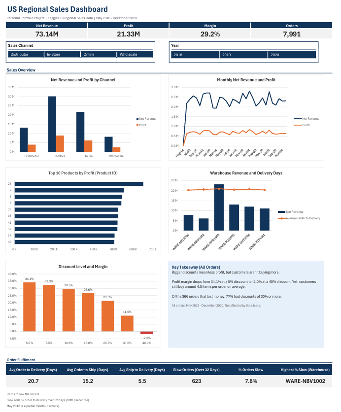
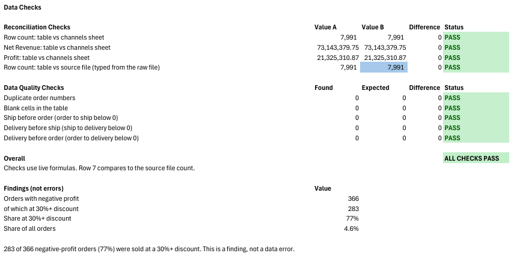
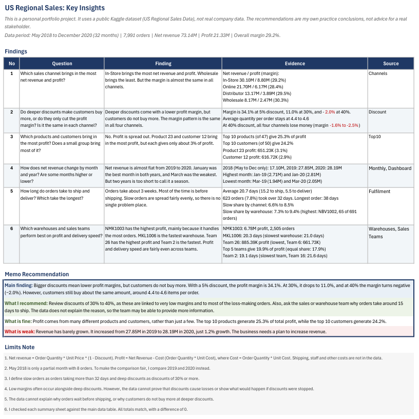

# US Regional Sales Analysis (Excel)

I looked at 7,991 sales orders from May 2018 to December 2020. I wanted to find out where the profit comes from (channels, products, customers, warehouses and sales teams), whether discounts help or hurt, how sales change over time, and how fast orders are delivered.

This is a personal portfolio project. The data is public and not from a real company. The conclusions are my own practice conclusions, not advice for a real business.

**Tools:** Excel (Power Query, Excel Tables, PivotTables, Pivot Charts, slicers) with formulas like SUMIFS, COUNTIFS, AVERAGEIFS, SUMPRODUCT, INDEX MATCH, LARGE, PERCENTILE, SORT, XLOOKUP, IF, and IFERROR.

GitHub cannot show Excel files in the browser, so I added screenshots below and a short video.

**Watch the 1-minute walkthrough:**

[Click here to watch the video](excel_dashboard.mp4)



## Quick numbers

|                 |                                                                           |
| --------------- | ------------------------------------------------------------------------- |
| Orders          | 7,991                                                                     |
| Net revenue     | 73.14M USD                                                                |
| Profit          | 21.33M USD                                                                |
| Profit margin   | 29.2%                                                                     |
| Period          | May 2018 to December 2020 (32 months)                                     |
| What I analysed | 4 sales channels, 47 products, 50 customers, 28 sales teams, 6 warehouses |

## Business questions

1. Which sales channel brings in the most net revenue and profit?
2. Do deeper discounts make customers buy more, or do they only cut the profit margin? Is it the same in each channel?
3. Which products and customers bring in the most profit? Does a small group bring most of it?
4. How does net revenue change by month and year? Are some months higher or lower?
5. How long do orders take to ship and deliver? Which take the longest?
6. Which warehouses and sales teams perform best on profit and delivery speed?

## What I found

1. **Channels.** In-Store brings in the most (30.10M net revenue, 8.80M profit). Wholesale brings in the least (8.17M, 2.47M). But the margin is almost the same in every channel, between 28.4% and 30.3%.
2. **Discounts.** Deeper discounts cut the margin, but customers do not buy more per order. The margin is 34.1% at a 5% discount, 11.0% at 30%, and -2.0% at 40%. The average quantity per order stays between 4.4 and 4.6 at every level.
3. **Loss-making orders.** 366 orders lost money (4.6% of all orders). 283 of them (77%) had a discount of 30% or more.
4. **Profit is spread out.** The top 10 products give 25.3% of profit and the top 10 customers give 24.2%. No single product or customer is above 3.1%. There is no 80/20 pattern.
5. **Revenue is flat.** Net revenue was 27.85M in 2019 and 28.19M in 2020, which is only 1.2% growth. January was the best month in both years. March was the weakest.
6. **Delivery.** An order takes 20.7 days on average (15.2 days to ship, 5.5 days to deliver). 623 orders (7.8%) took more than 32 days. The longest took 38 days. Slow orders are spread fairly evenly across channels and warehouses, so there is no single problem place.
7. **Warehouses and teams.** Warehouse NMK1003 has the highest profit (6.78M) mainly because it handles the most orders. MKL1006 is the fastest (20.3 days). Sales team 26 has the highest profit (885K) and team 6 the lowest (662K). The top 5 teams give 19.9% of profit, close to an equal share of 17.9%.

**What I would recommend**

- Review discounts of 30% to 40%. They are linked to very low margins and to most of the loss-making orders.
- Ask the sales or warehouse team why orders take around 15 days to ship. The data does not explain it.

## Data source and license

- **Data:** US Regional Sales Data from Kaggle (https://www.kaggle.com/datasets/talhabu/us-regional-sales-data/data)
- **License:** CC0 (public domain)
- **Size:** one sheet with 7,991 orders. All amounts are in USD.
- All 7,991 orders are already inside the workbook (Data sheet). To start from the original file, download it from the Kaggle link above.

## How I prepared the data

1. Loaded the Kaggle file with Power Query.
2. Set the data types. The dates were in day/month/year format, so I set the locale to UK to load them without errors.
3. Loaded the result as an Excel Table called `tblSales` (7,991 orders).
4. Added calculated columns (see the next section).
5. Checked the data. There are no duplicate order numbers, no blank cells and no negative delivery times. All amounts are in USD.

## Calculated columns

| Column            | How I calculated it                                                                    |
| ----------------- | -------------------------------------------------------------------------------------- |
| Revenue           | Order Quantity x Unit Price                                                            |
| Net Revenue       | Revenue x (1 - Discount Applied)                                                       |
| Cost              | Order Quantity x Unit Cost                                                             |
| Profit            | Net Revenue - Cost                                                                     |
| Margin            | Profit / Net Revenue                                                                   |
| Order to Ship     | Ship date - Order date (in days)                                                       |
| Ship to Delivery  | Delivery date - Ship date (in days)                                                    |
| Order to Delivery | Delivery date - Order date (in days)                                                   |
| Year              | The year of the order date                                                             |
| Month             | The first day of the order month, shown like May-18. I use it to group orders by month |
| Quarter           | Q1 to Q4, from the month of the order date                                             |
| Slow Order        | Shows "Slow" when Order to Delivery is more than 32 days                               |
| Slow Flag         | 1 for a slow order, 0 for all other orders (32 days or less)                           |

## Skills used

| Skill                                  | What I did                                                                                                                                                                        | Where to see it                                        |
| -------------------------------------- | --------------------------------------------------------------------------------------------------------------------------------------------------------------------------------- | ------------------------------------------------------ |
| Loading and cleaning data              | Used Power Query to load the file, set data types and fix the date format (day/month/year)                                                                                        | Data                                                   |
| Excel Tables and calculated columns    | Built a table (`tblSales`) with Revenue, Net Revenue, Cost, Profit, Margin, Order to Ship, Ship to Delivery, Order to Delivery, Year, Month, Quarter, Slow Order, and a Slow Flag | Data                                                   |
| Summary tables with formulas           | Built summaries by channel, product, customer, sales team and warehouse, using SUMIFS, COUNTIFS, AVERAGEIFS and SUMPRODUCT. Each one has a "check from tblSales" row              | Channels, Products, Customers, Sales Teams, Warehouses |
| Ranking and lookups                    | Used LARGE with lookups (XLOOKUP and INDEX MATCH) to build the Top 10 lists, with % of total profit and cumulative %                                                              | Top10                                                  |
| Trends                                 | Calculated month-on-month and year-on-year growth, and found the highest and lowest months                                                                                        | Monthly                                                |
| Business rules                         | Defined "slow order" (more than 32 days, found with PERCENTILE at the 90th percentile) and "deep discount" (30% or more, which is 30% and 40% in this data)                       | Fulfilment, Discount                                   |
| PivotTables, Pivot Charts, and slicers | Built PivotTables from `tblSales` and connected Sales Channel and Year slicers                                                                                                    | Pivots, Dashboard                                      |
| Dashboard design                       | KPI cards, 5 charts, a key takeaway box, and fulfilment cards                                                                                                                     | Dashboard                                              |
| Data checks                            | 9 checks on totals, duplicates, blanks and delivery dates. All pass                                                                                                               | Checks                                                 |
| Business writing                       | Wrote a findings table, a short business memo, and a limits note                                                                                                                  | Insight                                                |

## What is in the workbook

| Sheet       | What it does                                                                      |
| ----------- | --------------------------------------------------------------------------------- |
| Cover       | Project summary, notes, and how to refresh                                        |
| Data        | Order data with my calculated columns                                             |
| Channels    | Orders, net revenue, profit, and margin for each sales channel                    |
| Products    | The same for each product, plus units                                             |
| Customers   | The same for each customer, plus units                                            |
| Sales Teams | The same for each sales team, plus units, top and lowest team, and delivery speed |
| Warehouses  | The same for each warehouse, plus units and delivery times                        |
| Monthly     | Orders, net revenue, profit, margin, and growth for each month                    |
| Top10       | Top 10 products and customers by profit                                           |
| Fulfilment  | Delivery times and slow orders by channel and warehouse                           |
| Discount    | How each discount level changes the margin, for all orders and by channel         |
| Pivots      | The PivotTables that feed the dashboard                                           |
| Dashboard   | KPI cards, charts, and slicers                                                    |
| Checks      | Data checks and notes on loss-making orders                                       |
| Insight     | Findings, business memo, and limits                                               |

## Data checks

All 9 checks pass. They compare totals between the data table and each summary sheet. They also look for duplicate order numbers, blank cells, and orders that ship or arrive before they were ordered. See the `Checks` sheet.



## Limits

1. Net revenue = Order Quantity x Unit Price x (1 - Discount). Profit = Net Revenue - Cost, where Cost = Order Quantity x Unit Cost. Shipping, staff and other costs are not in the data.
2. May 2018 is only a partial month with 8 orders. To make the comparison fair, I compare 2019 and 2020 instead.
3. I define slow orders as orders taking more than 32 days and deep discounts as discounts of 30% or more (30% and 40% in this data).
4. Low margins often occur alongside deep discounts. However, the data cannot prove that discounts cause losses or show what would happen if discounts were stopped.
5. The data cannot explain why orders wait before shipping, or why customers do not buy more at deeper discounts.
6. I checked every summary sheet against the main data table. All totals match, with a difference of 0.



## Repo structure

```
us-regional-sales-excel/
├── README.md
├── US_Regional_Sales_Workbook.xlsx
├── excel_dashboard.mp4
└── images/
    ├── dashboard.png
    ├── checks.png
    └── insight.png
```

## How to refresh

Save a backup copy first. You cannot undo a refresh.

1. Replace the source file, or add the new rows. Keep the same column names. If the file moved, go to Data, Get Data, Data Source Settings, and change the source.
2. Go to Data, then click Refresh All.
3. Click Refresh All one more time. Power Query updates first and the PivotTables second.
4. On the Checks sheet, type the new row count into cell C7. I typed the old count by hand.
5. Check that all checks say PASS.
6. If new products, customers, sales teams, warehouses or months appear, check that the Products, Customers, Sales Teams, Warehouses and Monthly sheets and the Top10 lists include them. The "Difference" rows should stay at 0.
7. The slow-order rule (32 days) is one number in cell B1 on the Fulfilment sheet. If you change it, also change the text that says 32 days on the Cover, Dashboard and Insight sheets.
8. Read the Key takeaway box on the Dashboard and the Insight sheet again. I typed them by hand, so they do not update on their own.
